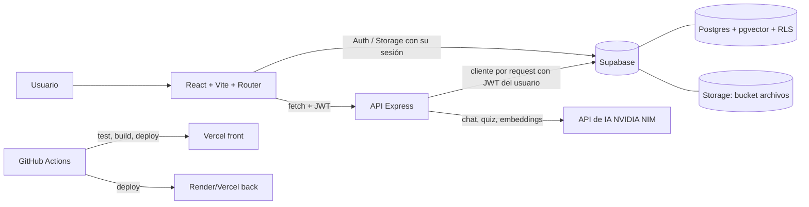

# PLAN.md — estudia-ai

App tipo NotebookLM: subes archivos, chateas con una IA que responde solo con su contenido (RAG) y generas cuestionarios. **Énfasis del proyecto: Supabase (BD, Auth, Storage, pgvector, RLS) y APIs.**

## 1. Arquitectura



### Flujos

**Subir documento**
1. Front sube el archivo a Storage en `archivos/{user_id}/{uuid}-{nombre}` (con la sesión del usuario).
2. Front llama `POST /api/documents` con `{ nombre, path }`.
3. Backend descarga el archivo (cliente con JWT del usuario), extrae texto (PDF con `pdf-parse`, TXT/MD directo), parte en chunks (~800 caracteres, solape 100), genera embeddings en lotes y guarda en `documents` y `chunks`.

**Chat (RAG)**
1. `POST /api/chat` `{ chat_id?, document_id, pregunta }`.
2. Embedding de la pregunta → `rpc('match_chunks')` top 5 → prompt con contexto + últimos 6 mensajes.
3. Instrucción al modelo: responder solo con el contexto; si no está, decir que no aparece en el documento.
4. Guarda mensaje del usuario y de la IA; responde `{ chat_id, respuesta, fuentes: [chunk_id] }`.

**Quiz**
1. `POST /api/quizzes` `{ document_id, num_preguntas (5–15), dificultad? }`.
2. Toma chunks representativos del documento, pide a la IA JSON estricto, valida con `zod` (reintento 1 vez si falla), guarda en `quizzes` y `questions`.
3. `POST /api/quizzes/:id/attempts` `{ respuestas: [int] }` → califica en servidor → guarda en `attempts`.

## 2. Estructura del repo

```
estudia-ai/
├─ supabase/migrations/001_init.sql
├─ server/
│  ├─ src/
│  │  ├─ index.js            # arranque
│  │  ├─ app.js              # express, helmet, cors, rate-limit, rutas
│  │  ├─ middleware/auth.js  # valida JWT, adjunta req.user y req.sb (cliente por request)
│  │  ├─ routes/{documents,chat,quizzes,stats}.js
│  │  └─ services/{ai,chunker,pdf,quizSchema}.js
│  ├─ tests/
│  └─ package.json
├─ client/
│  ├─ src/
│  │  ├─ components/{atoms,molecules,organisms}/
│  │  ├─ pages/{Login,Registro,Dashboard,Documento,Quiz,Historial}.jsx
│  │  ├─ hooks/  lib/{supabase,api}.js  styles/
│  │  └─ main.jsx
│  └─ package.json
├─ .github/workflows/ci.yml
├─ .env.example (raíz o por carpeta)
└─ README.md
```

## 3. Variables de entorno

Backend (`server/.env`):
```
PORT=3001
SUPABASE_URL=
SUPABASE_ANON_KEY=
NVIDIA_API_KEY=
NVIDIA_BASE_URL=https://integrate.api.nvidia.com/v1
AI_CHAT_MODEL=nvidia/nemotron-3-nano-30b-a3b
AI_EMBED_MODEL=nvidia/nv-embedqa-e5-v5
CLIENT_ORIGIN=http://localhost:5173
```
Frontend (`client/.env`):
```
VITE_SUPABASE_URL=
VITE_SUPABASE_ANON_KEY=
VITE_API_URL=http://localhost:3001
```
Nunca subir `.env` al repo. En producción van en los paneles de Vercel/Render y en GitHub Secrets.

## 4. API REST (Express)

Todas bajo `/api`, todas (menos `/health`) exigen `Authorization: Bearer <jwt de Supabase>`.

| Método | Ruta | Descripción | Códigos |
|---|---|---|---|
| GET | `/health` | Estado del servicio | 200 |
| POST | `/api/documents` | Procesa archivo ya subido a Storage | 201, 400, 401, 413 |
| GET | `/api/documents` | Lista documentos del usuario | 200 |
| DELETE | `/api/documents/:id` | Borra documento, chunks y archivo de Storage | 204, 404 |
| POST | `/api/chat` | Pregunta con RAG | 200, 400 |
| GET | `/api/chats/:id/messages` | Historial del chat | 200, 404 |
| POST | `/api/quizzes` | Genera quiz del documento | 201, 400 |
| GET | `/api/quizzes/:id` | Quiz con preguntas | 200, 404 |
| POST | `/api/quizzes/:id/attempts` | Califica y guarda intento | 201, 400 |
| GET | `/api/stats` | Historial de intentos y promedio | 200 |

Reglas: validar entradas con `zod`, errores en formato `{ error: { code, message } }`, límite de archivo 10 MB (pdf, txt, md), `helmet`, CORS solo `CLIENT_ORIGIN`, `express-rate-limit` en `/api/chat` y `/api/quizzes`.

## 5. Base de datos

Se define en `001_init.sql` (7 tablas, RLS en todas, función `match_chunks`, bucket privado `archivos` con políticas por carpeta de usuario). Embeddings de **1024 dimensiones** (`nvidia/nv-embedqa-e5-v5`, dimensión fija). Al guardar chunks usar `input_type: "passage"` y al buscar con la pregunta `input_type: "query"`. Si se cambia de modelo de embeddings, ajustar `vector(N)` en la migración.

## 6. Fases

Cada fase: rama propia, commits pequeños, PR, tests verdes antes del merge.

### Fase 0 — Verificación de acceso
- `gh auth status`, `supabase projects list`, `vercel whoami`, `node -v` (≥ 20), `git --version`.
- Confirmar que el MCP del navegador ve las sesiones de Supabase/GitHub/Vercel.
- **Listo cuando:** todos los accesos responden; si falta algo, se me avisa.

### Fase 1 — Repo y estructura (Git/GitHub)
- Crear repo `estudia-ai` en GitHub con `gh`, clonar, crear estructura de la sección 2, `.gitignore` (node_modules, .env, dist), `README.md` inicial, rama `main` protegida por PR si es posible.
- Instalar dependencias: server (`express cors helmet express-rate-limit zod multer pdf-parse @supabase/supabase-js openai dotenv`, dev: `jest supertest nodemon eslint`), client (`vite react react-router-dom @supabase/supabase-js`, dev: `vitest @testing-library/react @testing-library/jest-dom jsdom eslint`).
- **Listo cuando:** `npm run dev` levanta server y client vacíos; primer commit en GitHub.

### Fase 2 — Supabase (núcleo)
- Crear o enlazar proyecto Supabase (`supabase init`, `supabase link`). Si hay que crearlo, usar CLI o el navegador; guardar la contraseña de BD solo en `.env` local.
- Aplicar `supabase/migrations/001_init.sql` con `supabase db push`.
- Auth: habilitar email/password. En desarrollo desactivar confirmación por correo para poder probar; documentarlo en el README.
- **Prueba de RLS (obligatoria):** crear dos usuarios de prueba, insertar un documento con A y comprobar que B no lo ve ni lo puede modificar. Guardar la prueba como script en `supabase/tests/` o en los tests del backend.
- **Listo cuando:** migración aplicada, 7 tablas con RLS activo, bucket `archivos` privado, prueba de aislamiento pasa.

### Fase 3 — Backend base (Node, Express, JWT)
- `app.js` con helmet, cors, json, rate limit, `/health`, manejador de errores global.
- `middleware/auth.js`: lee `Authorization`, valida el token con `supabase.auth.getUser(token)`, adjunta `req.user` y `req.sb` (cliente de Supabase creado con la anon key y el header Authorization del usuario).
- Tests con supertest: sin token → 401, token inválido → 401, `/health` → 200.
- **Listo cuando:** rutas protegidas devuelven 401 sin token y pasan con token válido.

### Fase 4 — Pipeline de documentos
- `services/pdf.js`, `services/chunker.js`, `services/ai.js` (cliente `openai` apuntando a `NVIDIA_BASE_URL`; funciones `embed(textos[], tipo)` y `chat(mensajes)`).
- Rutas `documents` (crear, listar, borrar). Borrar también el archivo de Storage.
- Validar tipo y tamaño. Embeddings en lotes. Si falla a la mitad, limpiar lo insertado.
- Tests: chunker (tamaños y solape), validación de entrada, ruta con IA mockeada.
- **Listo cuando:** subir un PDF de prueba crea el documento y sus chunks con embeddings en Supabase.

### Fase 5 — Chat RAG
- Ruta `POST /api/chat` y `GET /api/chats/:id/messages` según sección 1.
- Prompt de sistema que obliga a responder solo con el contexto y a admitir cuando no hay información.
- Tests con IA mockeada: crea chat nuevo, reutiliza chat, guarda 2 mensajes por turno.
- **Listo cuando:** una pregunta sobre el PDF devuelve respuesta coherente y cita fuentes; una pregunta fuera del documento recibe "no aparece en el documento".

### Fase 6 — Quizzes
- `services/quizSchema.js` (zod): `{ titulo, preguntas: [{ pregunta, opciones: [4 strings], correcta: 0-3, explicacion }] }`.
- Rutas de generación, lectura, intento y `/api/stats`.
- Calificación en servidor.
- **Listo cuando:** se genera un quiz válido, se contesta, el puntaje se guarda y aparece en `/api/stats`.

### Fase 7 — Frontend (React, Router, Hooks, Atomic Design)
- Páginas: `/login`, `/registro`, `/` (dashboard con lista y subida de documentos), `/doc/:id` (pestañas Chat y Quiz), `/quiz/:id`, `/historial`.
- Rutas protegidas con contexto de sesión (`onAuthStateChange`). `lib/api.js` agrega el JWT automáticamente a cada `fetch`.
- Estados de carga, error y vacío en todas las vistas. Subida de archivo con barra de progreso o estado claro.
- Atomic Design: atoms (Button, Input, Spinner), molecules (FormField, ChatBubble, QuestionCard), organisms (ChatPanel, QuizRunner, DocumentList), templates/pages.
- Responsive mobile-first con Flexbox/Grid. Accesibilidad: HTML semántico, labels, foco visible, contraste AA, navegación por teclado, `aria-live` para respuestas del chat.
- Diseño limpio y moderno; que no se vea genérico.
- **Listo cuando:** flujo completo funciona en local: registro → subir → chatear → generar quiz → contestar → ver historial.

### Fase 8 — Testing
- Backend: Jest + supertest (auth, validaciones, rutas con IA mockeada).
- Frontend: Vitest + React Testing Library (login, lista de documentos, QuizRunner calcula selección).
- Objetivo: tests de las rutas críticas y componentes clave; no perseguir 100% de cobertura.
- **Listo cuando:** `npm test` pasa en server y client.

### Fase 9 — CI/CD y deploy
- `.github/workflows/ci.yml`: en cada push y PR → instalar, lint, test, build de ambos paquetes.
- Deploy del frontend a Vercel (vía `vercel` CLI o integración con GitHub) con sus variables de entorno.
- Deploy del backend (Render o Vercel serverless); configurar `CLIENT_ORIGIN` con la URL real del frontend y `VITE_API_URL` con la del backend.
- Supabase Auth: agregar la URL de producción en Site URL / Redirect URLs.
- Secrets en GitHub para lo que haga falta, sin imprimirlos en logs.
- **Listo cuando:** push a `main` ejecuta CI y despliega; la app en producción completa el flujo de punta a punta.

### Fase 10 — Accesibilidad, SEO y pulido
- Lighthouse (accesibilidad y SEO ≥ 90 en las páginas públicas). Meta tags, título por ruta, `lang="es"`, favicon.
- Revisar contraste, foco, textos alternativos y mensajes de error legibles.
- Manejo de errores amables (sin stack traces al usuario) y límites claros (tamaño de archivo, formato).
- **Listo cuando:** Lighthouse documentado en el README y sin errores críticos de accesibilidad.

### Fase 11 — Documentación y entrega
- `README.md` completo (ver PROMPT.md, sección Entregables).
- Capturas de pantalla de las vistas principales y de Supabase (tablas, RLS).
- Entregar: URLs de producción, link del repo y pendientes manuales.

## 7. Temas del manual cubiertos (fullstackjunior.ciberecus.mx)

| Tema del manual | Dónde se cubre |
|---|---|
| 1.2 Entorno de desarrollo | Fase 0–1 (Node, git, CLI, editor) |
| 1.3 HTML semántico · 1.4 Accesibilidad | Fase 7 y 10 |
| 1.5 CSS · 1.6 Flexbox/Grid · 1.7 Responsive | Fase 7 |
| 1.8 JS ES6+ · 1.9 DOM y eventos · 1.10 Async/Fetch | Fase 7 (hooks, eventos, `lib/api.js`) |
| 1.11 UI/UX · 1.12 Proyecto integrador | Fase 7 y 11 |
| 1.13 Hosting/cloud/dominios | Fase 9 |
| 2.1 Git y GitHub | Todas (ramas, PRs, commits) |
| 2.6 Node y npm · 2.7 Express | Fase 1 y 3 |
| 2.8 PostgreSQL · 2.12 Supabase | Fase 2 |
| 2.10 API REST con JWT | Fase 3 |
| 2.11 Deploy · 2.13 Proyecto integrador API | Fase 9 y 11 |
| 3.1 React · 3.2 Hooks · 3.3 Estilos · 3.4 Router | Fase 7 |
| 3.5 Consumo de APIs | Fase 4–7 (IA + Supabase + API propia) |
| 3.6 Atomic Design | Fase 7 |
| 3.7 Accesibilidad y SEO | Fase 10 |
| 3.8 Testing | Fase 8 |
| 3.9 CI/CD | Fase 9 |
| 3.10 Proyecto final integrador | Todo el proyecto |
| 2.2–2.5 PHP/MySQL/CPanel · 2.9 MongoDB | **No incluidos** (el proyecto usa Supabase/Postgres). Opcional: mini módulo aparte si la rúbrica lo exige |

## 8. Checklist final de entrega

- [ ] RLS activo en las 7 tablas y probado con dos usuarios
- [ ] Bucket `archivos` privado con políticas por usuario
- [ ] Ninguna llave en el repo (revisar historial con `git log -p | grep -i key`)
- [ ] Todas las rutas protegidas devuelven 401 sin token
- [ ] Flujo completo funciona en producción
- [ ] CI verde en `main`
- [ ] README con diagrama, endpoints, capturas y tabla de temas del manual
- [ ] Lighthouse accesibilidad y SEO documentados
