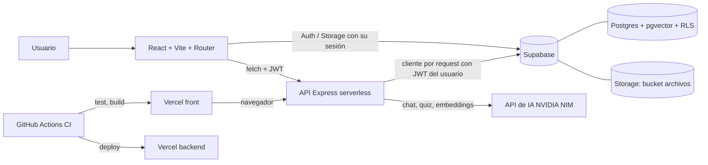
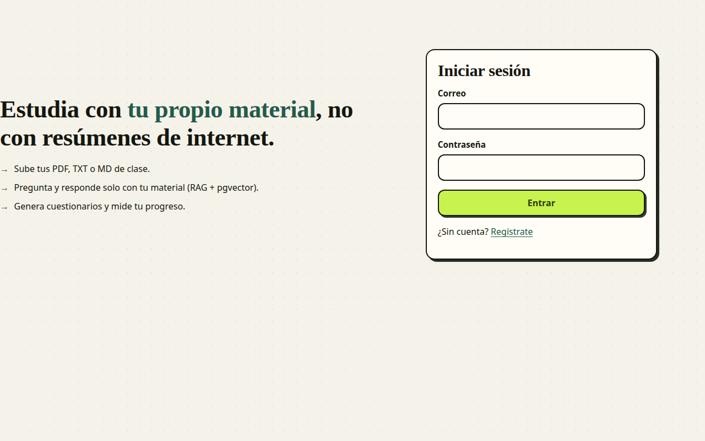
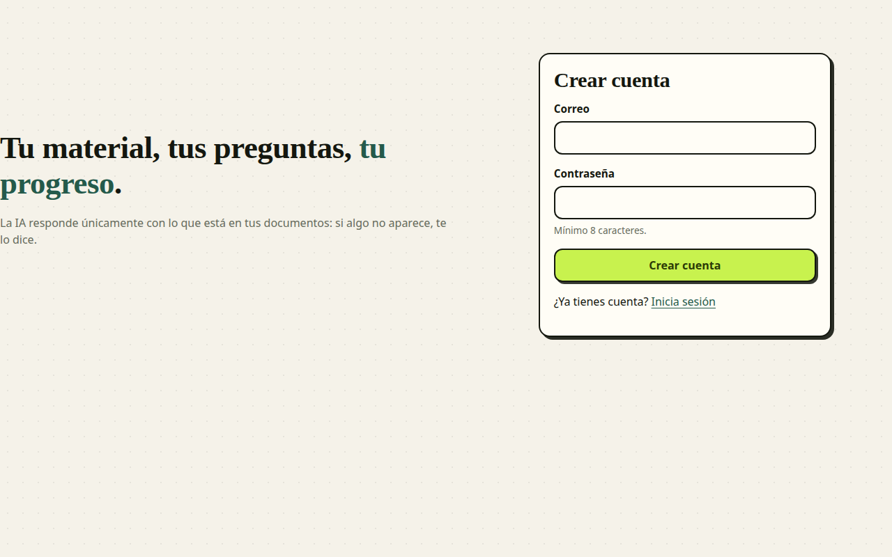
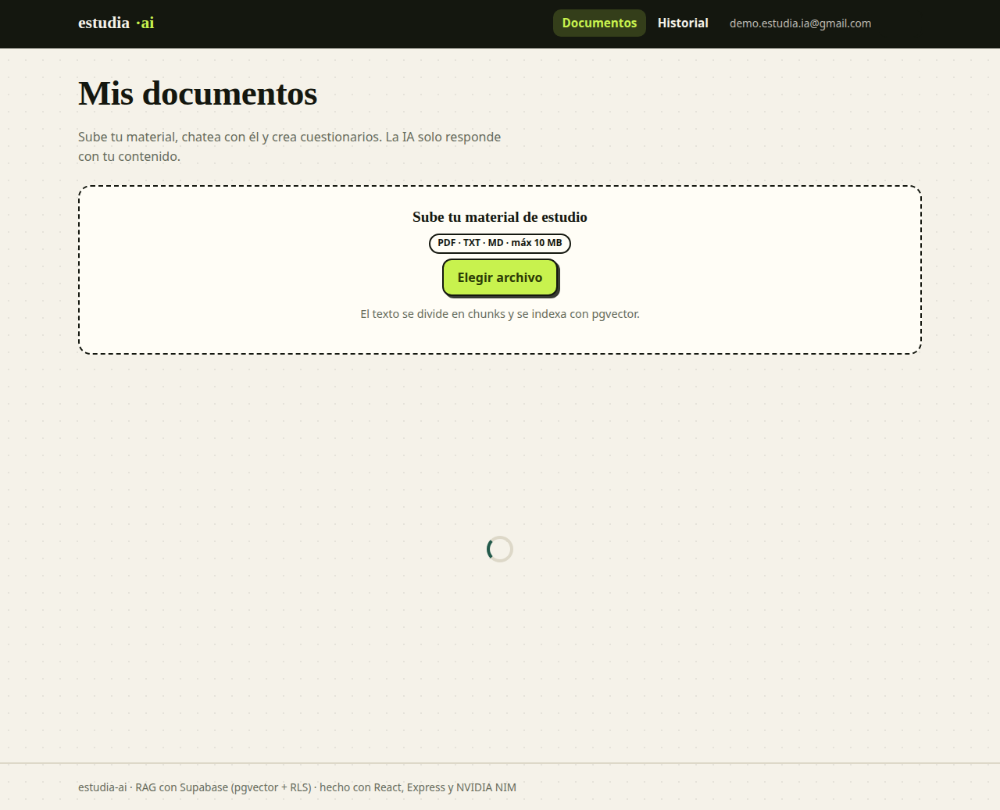
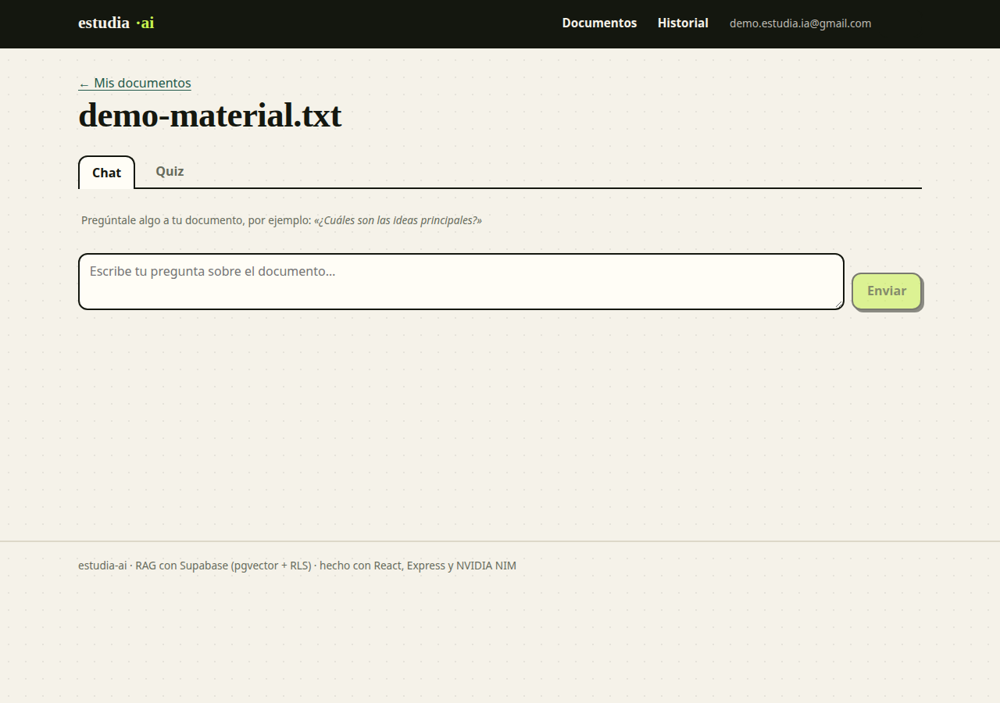
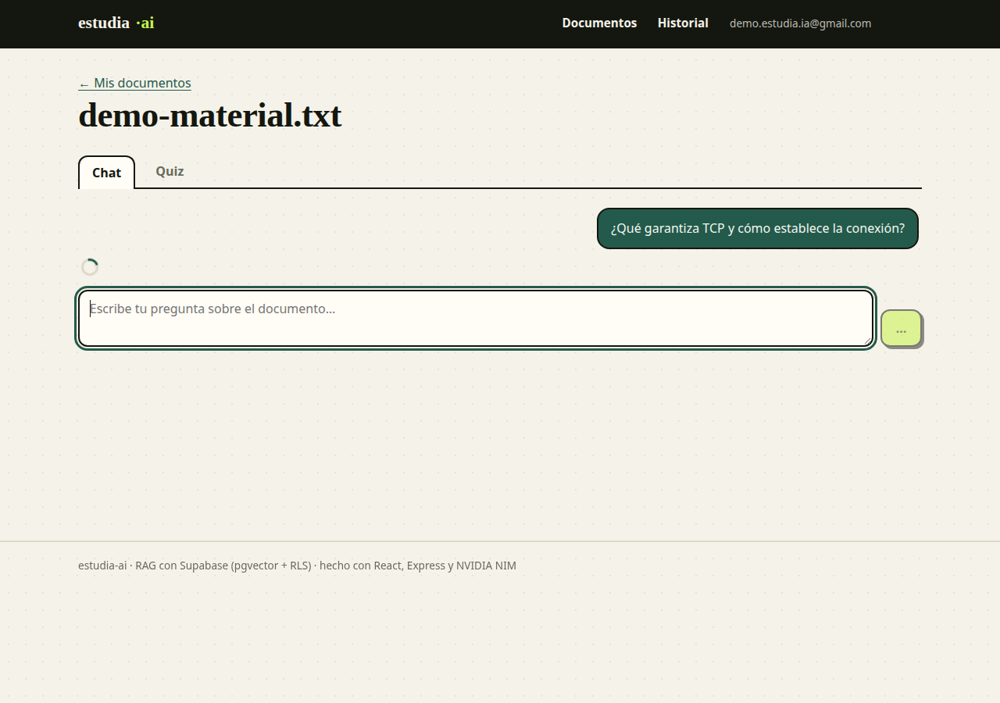
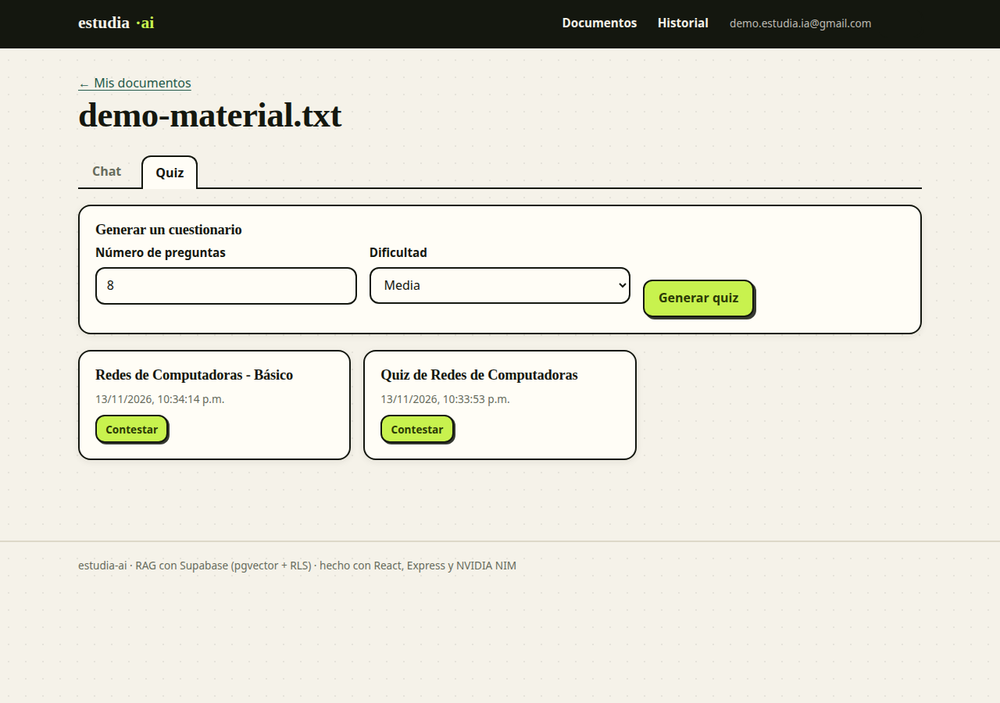
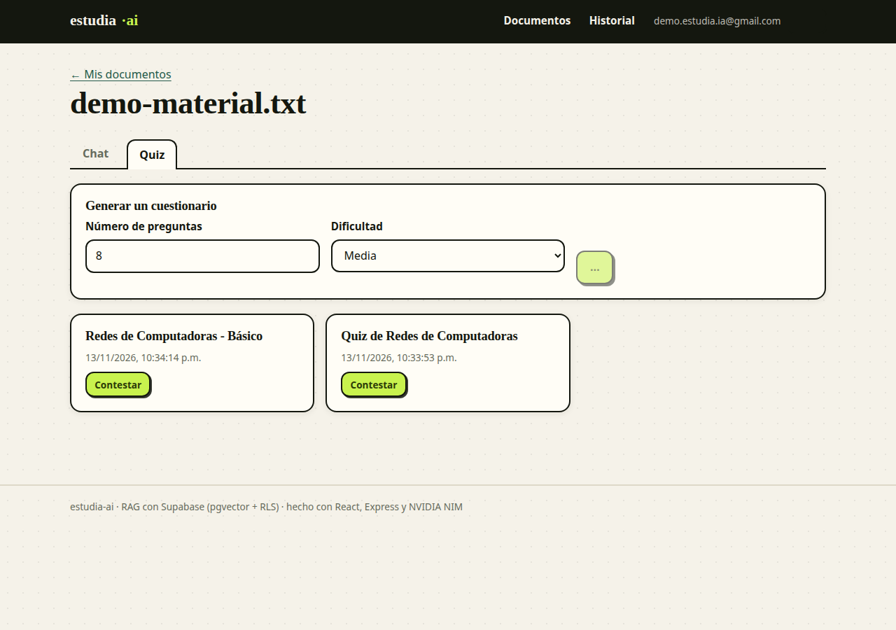
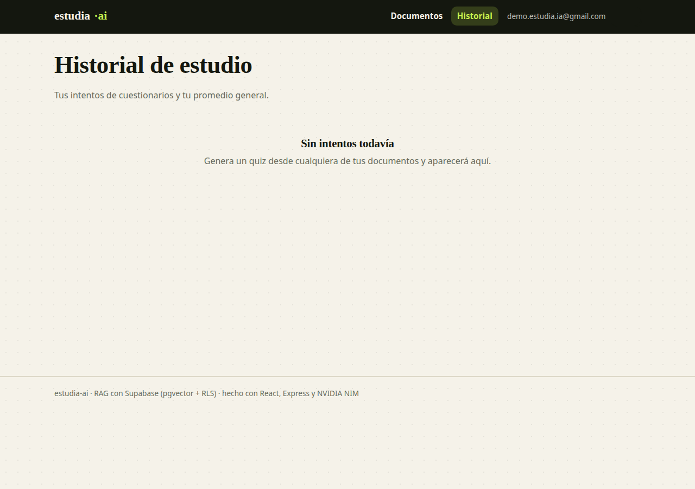

# estudia-ai

App tipo **NotebookLM** con énfasis en **Supabase** (Auth, Postgres + pgvector, Storage, RLS) y APIs.

Sube archivos de estudio (**PDF, TXT, MD**), chatea con una IA que responde **solo con el contenido de tus documentos** (RAG + pgvector), genera **cuestionarios de opción múltiple** y mide tu progreso. Nada de resúmenes de internet: si algo no aparece en tu material, la IA te lo dice.

> Repo público: https://github.com/villaralan11/estudia-ai  
> Producción: https://estudia-ai-amber.vercel.app (front) · https://estudia-ai-api.vercel.app (backend)

---

## Arquitectura



### Stack

| Capa | Tecnología |
|------|------------|
| Frontend | React 18 + Vite + React Router, CSS propio |
| Backend | Node 20 + Express (ESM), desplegado en Vercel serverless |
| Datos | Supabase: Postgres + pgvector (HNSW/halfvec), Auth, Storage, RLS en todas las tablas |
| IA | NVIDIA NIM vía SDK `openai` (chat `nemotron-3.5-lightning-30b-a3b`, embeddings `nemotron-3.5-embed-1b`, 2048 dims) |
| Tests | Jest + supertest (backend, 33) · Vitest + RTL (frontend, 11) |
| CI/CD | GitHub Actions + Vercel Git Integration |

### Principio de seguridad

Ninguna llave en el repositorio. El backend crea un cliente Supabase **por request** con el JWT del usuario, así que PostgREST aplica RLS con la identidad de quien pide; **nunca usa `service_role`** desde el frontend.

---

## Despliegue en producción

- **Frontend:** https://estudia-ai-amber.vercel.app  
- **Backend:** https://estudia-ai-api.vercel.app  

CD automático vía GitHub Actions y Vercel Git Integration (push a `main` despliega solo).

### Endpoints (todos bajo `/api`, menos `/health`, exigen `Authorization: Bearer <jwt>`)

| Método | Ruta | Descripción | Códigos |
|--------|------|-------------|---------|
| GET | `/health` | Estado del servicio | 200 |
| POST | `/api/documents` | Procesa archivo ya subido a Storage (extrae texto, chunks, embeddings) | 201, 400, 401, 413 |
| GET | `/api/documents` | Lista documentos del usuario | 200 |
| DELETE | `/api/documents/:id` | Borra documento, chunks y archivo de Storage | 204, 404 |
| POST | `/api/chat` | Pregunta con RAG (responde solo con el contexto) | 200, 400 |
| GET | `/api/chats/:id/messages` | Historial del chat | 200, 404 |
| POST | `/api/quizzes` | Genera quiz del documento (5–15 preguntas) | 201, 400 |
| GET | `/api/quizzes/:id` | Quiz con preguntas (sin revelar respuestas correctas) | 200, 404 |
| POST | `/api/quizzes/:id/attempts` | Califica en servidor y guarda el intento | 201, 400 |
| GET | `/api/stats` | Historial de intentos y promedio general | 200 |

Reglas: validación con `zod`, errores en formato `{ error: { code, message } }`, archivos ≤ 10 MB (pdf/txt/md), `helmet`, CORS restringido al origen del front, rate-limit en `/api/chat` y `/api/quizzes`.

---

## Variables de entorno

Nunca subir `.env` al repo (está en `.gitignore`). Ejemplos vacíos en `server/.env.example` y `client/.env.example`.

Backend (`server/.env`):

```env
PORT=3001
SUPABASE_URL=https://<proyecto>.supabase.co
SUPABASE_ANON_KEY=<anon key>
NVIDIA_API_KEY=<clave de NVIDIA NIM>
NVIDIA_BASE_URL=https://integrate.api.nvidia.com/v1
AI_CHAT_MODEL=nvidia/nemotron-3.5-lightning-30b-a3b
AI_EMBED_MODEL=nvidia/nemotron-3.5-embed-1b
CLIENT_ORIGIN=https://estudia-ai-amber.vercel.app
```

Frontend (`client/.env`):

```env
VITE_SUPABASE_URL=https://<proyecto>.supabase.co
VITE_SUPABASE_ANON_KEY=<anon key>
VITE_API_URL=https://estudia-ai-api.vercel.app
```

La `NVIDIA_API_KEY` solo va en el backend.

---

## Base de datos (Supabase)

- 7 tablas con **RLS activo** (verificado por catálogo y por prueba con dos usuarios reales): `documents`, `chunks`, `chats`, `messages`, `quizzes`, `questions`, `attempts`.
- Función `match_chunks(query_embedding vector(2048), doc_id uuid, match_count int)` con índice HNSW sobre `halfvec(2048)` (pgvector limita HNSW sobre `vector` a 2000 dims; el modelo entrega 2048).
- Bucket privado `archivos` (10 MB, `application/pdf`, `text/plain`, `text/markdown`); política por carpeta de usuario (`{user_id}/…`).
- Auth email+password con confirmación automática de correo en desarrollo.

### Prueba de aislamiento RLS (dos usuarios)

Guardada en `supabase/tests/rls.test.mjs`. Usuario A sube un documento y su archivo; usuario B **no puede** leerlo, listarlo, modificarlo, borrarlo, insertarle chunks ni descargar/escribir su archivo en Storage. Resultado: **PASS**.

---

## Flujos

**Subir documento**
1. El front sube el archivo a Storage en `archivos/{user_id}/{uuid}-{nombre}` con la sesión del usuario.
2. Llama `POST /api/documents` con `{ nombre, path }`.
3. El backend descarga el archivo (cliente con JWT del usuario), extrae texto (PDF con `pdf-parse`, TXT/MD directo), lo parte en chunks (~800 caracteres, solape 100), genera embeddings en lotes y guarda en `documents` + `chunks`. Si falla a la mitad, hace rollback del documento.

**Chat (RAG)**
1. `POST /api/chat` `{ chat_id?, document_id, pregunta }`.
2. Embedding de la pregunta → `match_chunks` top 5 → prompt con contexto + últimos 6 mensajes.
3. Instrucción al modelo: responder solo con el contexto, citar fuentes con `[Fuente N]`; si no está, decir exactamente `"No aparece en el documento."`.
4. Guarda mensaje del usuario y de la IA; responde `{ chat_id, respuesta, fuentes }`.

**Quiz**
1. `POST /api/quizzes` `{ document_id, num_preguntas, dificultad }`.
2. La IA devuelve JSON estricto validado con `zod` (reintento 1 vez si falla); se guardan `quizzes` y `questions` (sin revelar `correcta` al cliente).
3. `POST /api/quizzes/:id/attempts` `{ respuestas: [int] }` → calificación en servidor → guarda en `attempts`.
4. `GET /api/stats` devuelve intentos y promedio.

---

## Desarrollo rápido

```bash
npm run install:all   # npm install en server y client
cp server/.env.example server/.env   # completa las variables
cp client/.env.example client/.env   # completa las variables
npm run dev           # levanta server (3001) y client (5173)
```

Scripts del monorepo: `install:all`, `dev`, `dev:server`, `dev:client`, `test`, `lint`, `build`.

---

## Testing

| Paquete | Framework | Tests | Estado |
|---------|-----------|-------|--------|
| server | Jest + supertest | 33 | ✅ verdes |
| client | Vitest + RTL | 11 | ✅ verdes |

CI (`.github/workflows/ci.yml`): lint + test + build de ambos paquetes en cada push/PR; job de despliegue opcional si existe el secret `VERCEL_TOKEN`.

---

## Lighthouse (páginas públicas, producción)

| Página | Performance | Accesibilidad | Best Practices | SEO |
|--------|-------------|---------------|----------------|-----|
| `/login` | 99 | 100 | 100 | 91 |
| `/registro` | 99 | 100 | 100 | 91 |

Criterio Fase 10: accesibilidad y SEO ≥ 90 en las páginas públicas. ✅

---

## Capturas de producción

Páginas públicas:

- 
- 

Flujo autenticado (usuario real en producción, sesión inyectada):

- 
- 
- 
- 
- 
- 

---

## Temas del manual cubiertos (fullstackjunior.ciberecus.mx)

| Tema del manual | Dónde se cubre |
|-----------------|----------------|
| 1.2 Entorno de desarrollo | Fase 0–1 (Node, git, CLI, editor) |
| 1.3 HTML semántico · 1.4 Accesibilidad | Fase 7 y 10 |
| 1.5 CSS · 1.6 Flexbox/Grid · 1.7 Responsive | Fase 7 |
| 1.8 JS ES6+ · 1.9 DOM y eventos · 1.10 Async/Fetch | Fase 7 (hooks, eventos, `lib/api.js`) |
| 1.11 UI/UX · 1.12 Proyecto integrador | Fase 7 y 11 |
| 1.13 Hosting/cloud/dominios | Fase 9 |
| 2.1 Git y GitHub | Todas (ramas, PRs, commits) |
| 2.6 Node y npm · 2.7 Express | Fase 1 y 3 |
| 2.8 PostgreSQL · 2.12 Supabase | Fase 2 |
| 2.10 API REST con JWT | Fase 3 |
| 2.11 Deploy · 2.13 Proyecto integrador API | Fase 9 y 11 |
| 3.1 React · 3.2 Hooks · 3.3 Estilos · 3.4 Router | Fase 7 |
| 3.5 Consumo de APIs | Fase 4–7 (IA + Supabase + API propia) |
| 3.6 Atomic Design | Fase 7 |
| 3.7 Accesibilidad y SEO | Fase 10 |
| 3.8 Testing | Fase 8 |
| 3.9 CI/CD | Fase 9 |
| 3.10 Proyecto final integrador | Todo el proyecto |
| 2.2–2.5 PHP/MySQL/CPanel · 2.9 MongoDB | **No incluidos** (el proyecto usa Supabase/Postgres) |

---

## Checklist final de entrega

- [x] RLS activo en las 7 tablas y probado con dos usuarios (B no toca datos de A)
- [x] Bucket `archivos` privado con políticas por usuario
- [x] Ninguna llave en el repo (`git log -p | grep -i key` limpio)
- [x] Todas las rutas protegidas devuelven 401 sin token
- [x] Flujo completo funciona en producción (registro → upload → chat → quiz → stats → delete)
- [x] CI verde en `main`
- [x] README con diagrama, endpoints, capturas y tabla de temas del manual
- [x] Lighthouse accesibilidad y SEO documentados (≥ 90)

---

## Pendientes manuales (documentados)

- Crear el secret `VERCEL_TOKEN` en GitHub para que el job de despliegue de CI se active (el scope del token de CLI falló; crear desde el dashboard de Vercel).
- Rotar `NVIDIA_API_KEY` (fue expuesta accidentalmente en el chat durante el desarrollo).
- Dominio personalizado si se desea (actualmente subdominios de Vercel).

---

*estudia-ai — estudia con tu propio material, no con resúmenes de internet.*
